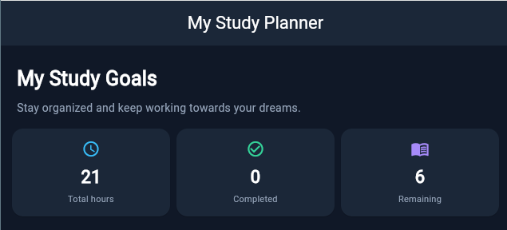
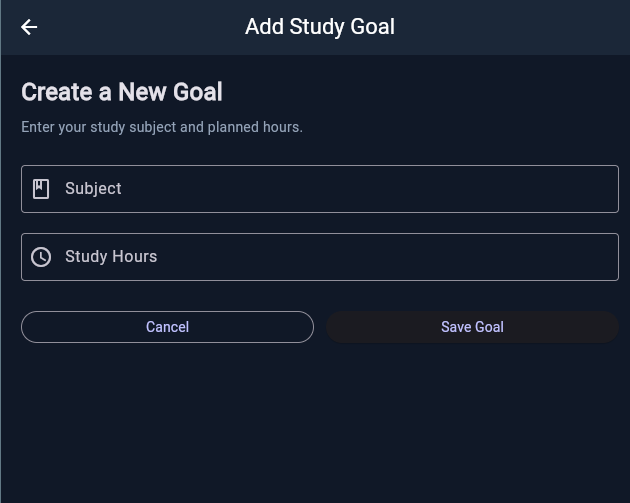
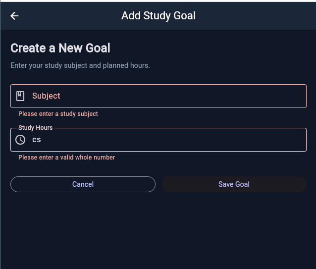
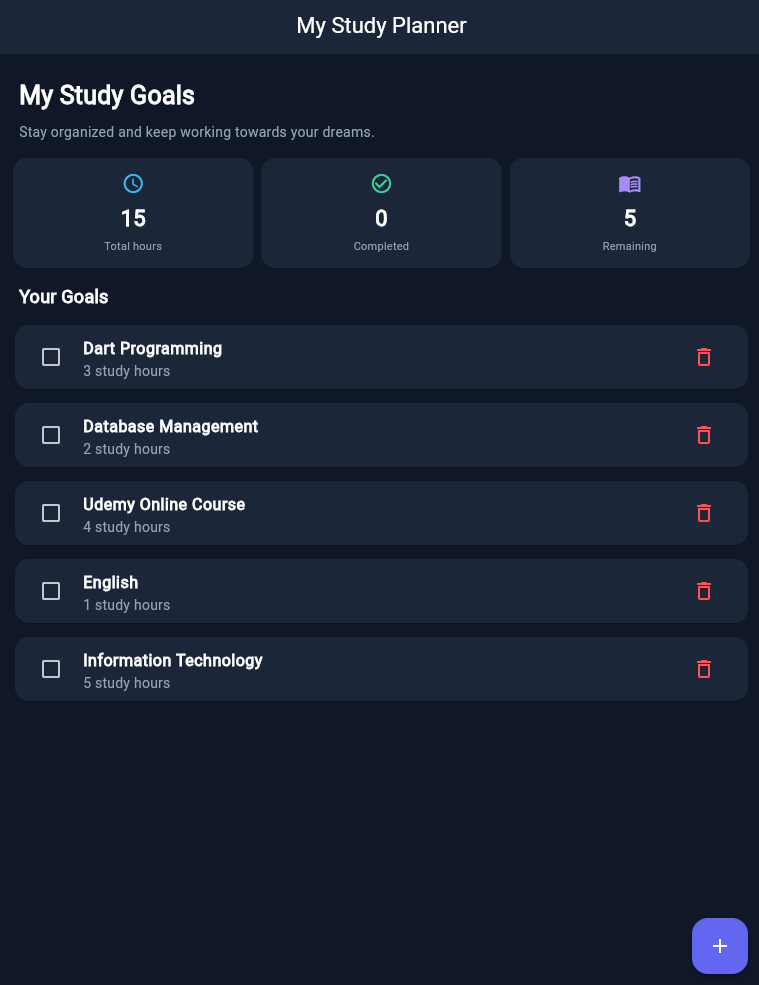

# My Study Planner

A Flutter mobile application designed to help students organize, manage, and track their study goals.

The application allows students to create study goals, specify planned study hours, mark goals as completed, delete goals, and monitor their progress through live statistics.

Developed using **Dart and Flutter** as a group assignment for the Mobile App Development course at the **University of Lay Adventists of Kigali (UNILAK)**.

---

## Features

- **Add Study Goals:** Create a study goal by entering a subject and planned study hours.
- **Separate Add Goal Screen:** Add new goals through a dedicated form screen.
- **Input Validation:**
  - Subject name cannot be empty.
  - Study hours must be numeric.
  - Study hours must be greater than zero.
- **Mark Goals as Completed:** Mark a goal as done or undo its completion.
- **Visual Completion Indicator:** Completed goals are displayed with strike-through text.
- **Delete Goals:** Remove unwanted study goals.
- **Live Statistics:**
  - Total planned study hours.
  - Number of completed goals.
  - Number of remaining goals.
- **Empty State:** Display a friendly message when there are no study goals.
- **Dark Theme:** A modern dark navy-blue user interface.

**Current data storage:** Study goals are currently managed in application memory. They are not permanently saved after closing the application. SQLite persistence is planned for Phase 5.

---

## Application Screenshots

### 1. Home Screen

Displays study goals and live statistics, including total planned hours, completed goals, and remaining goals.



### 2. Add Goal Screen

Allows students to enter a subject name and the number of planned study hours.



### 3. Form Validation

Validates user input to ensure that the subject is not empty and study hours are valid and greater than zero.



### 4. Completed Goals

Demonstrates how completed study goals are visually distinguished using strike-through text.



---

## Project Development Phases

The project is organized into five development phases.

| Phase | Title                | Description                                                                              |
| ----- | -------------------- | ---------------------------------------------------------------------------------------- |
| 1     | Static Screen        | MaterialApp, Scaffold, AppBar, fixed study goal cards, and floating action button.       |
| 2     | Working List         | StatefulWidget, List of Maps, adding, completing, and deleting goals using setState().   |
| 3     | Statistics & Cards   | Live statistics using getters, fold(), where(), and reusable StatCard widget.            |
| 4     | Second Screen        | AddGoalScreen, Navigator.push(), Navigator.pop(), text controllers, and form validation. |
| 5     | Database Persistence | Planned implementation of SQLite using sqflite and a separate database_helper.dart file. |

**Current submission progress:** Phases 1–4 have been implemented and tested on a web browser and a physical Android device. Phase 5 has not yet been implemented.

---

## Project Structure

```text
study_planner/
│
├── android/
│
├── ios/
│
├── lib/
│   └── main.dart
│
├── test/
│
├── web/
│
├── screenshots/
│   ├── home_screen.png
│   ├── add_goal_screen.png
│   ├── form_validation.png
│   └── completed_goals.png
│
├── pubspec.yaml
├── pubspec.lock
├── analysis_options.yaml
└── README.md
```

### Main Files

- **main.dart:** Contains the application entry point, home screen, study goal management, statistics, and Add Goal screen.
- **pubspec.yaml:** Defines the project dependencies and Flutter configuration.
- **screenshots/:** Contains screenshots demonstrating the application interface and functionality.

---

## Technologies Used

| Technology         | Purpose                                  |
| ------------------ | ---------------------------------------- |
| Dart               | Main programming language                |
| Flutter            | Mobile application development framework |
| Material Design    | User interface components                |
| Visual Studio Code | Code editor and development environment  |
| Android Studio     | Android SDK and development tools        |
| Git                | Version control                          |
| GitHub             | Source code hosting and collaboration    |

---

## How to Run the Project

### Prerequisites

Before running the application, make sure you have installed:

- Flutter SDK.
- Dart SDK.
- Visual Studio Code or Android Studio.
- Git.
- An Android device or emulator.

### 1. Clone the Repository

```bash
git clone https://github.com/BYUKUSENGE1122/study_planner.git
```

### 2. Navigate to the Project Directory

```bash
cd study_planner
```

### 3. Install Dependencies

```bash
flutter pub get
```

### 4. Check Available Devices

```bash
flutter devices
```

### 5. Run the Application

```bash
flutter run
```

You can run the application on a connected Android device or a supported development platform.

---

## Key Flutter Concepts Demonstrated

This project demonstrates practical understanding of the following Dart and Flutter concepts:

- MaterialApp and Scaffold.
- StatelessWidget and StatefulWidget.
- Widget composition and reusable components.
- List<Map<String, dynamic>> for managing study goals.
- ListView.builder for displaying dynamic lists.
- setState() for updating the user interface.
- Getters for calculating live statistics.
- fold() for calculating total study hours.
- where() for filtering completed and remaining goals.
- TextEditingController for handling form input.
- Form and TextFormField for input validation.
- Navigator.push() and Navigator.pop() for screen navigation.
- dispose() for releasing text controller resources.

---

## Group Information

**Institution:** University of Lay Adventists of Kigali (UNILAK)

**Course:** Mobile App Development (Dart & Flutter)

**Project Title:** My Study Planner

**Assignment Type:** Group Assignment

### Group Members

## Group NO: 14

💠25952/2024
💠26710/2024
💠26229/2024
💠26734/2024
💠27066/2024

---

## Project Objective

The main objective of My Study Planner is to help students improve their study organization by creating personal study goals, tracking planned study hours, monitoring completed tasks, and managing their learning progress through a simple mobile application.
